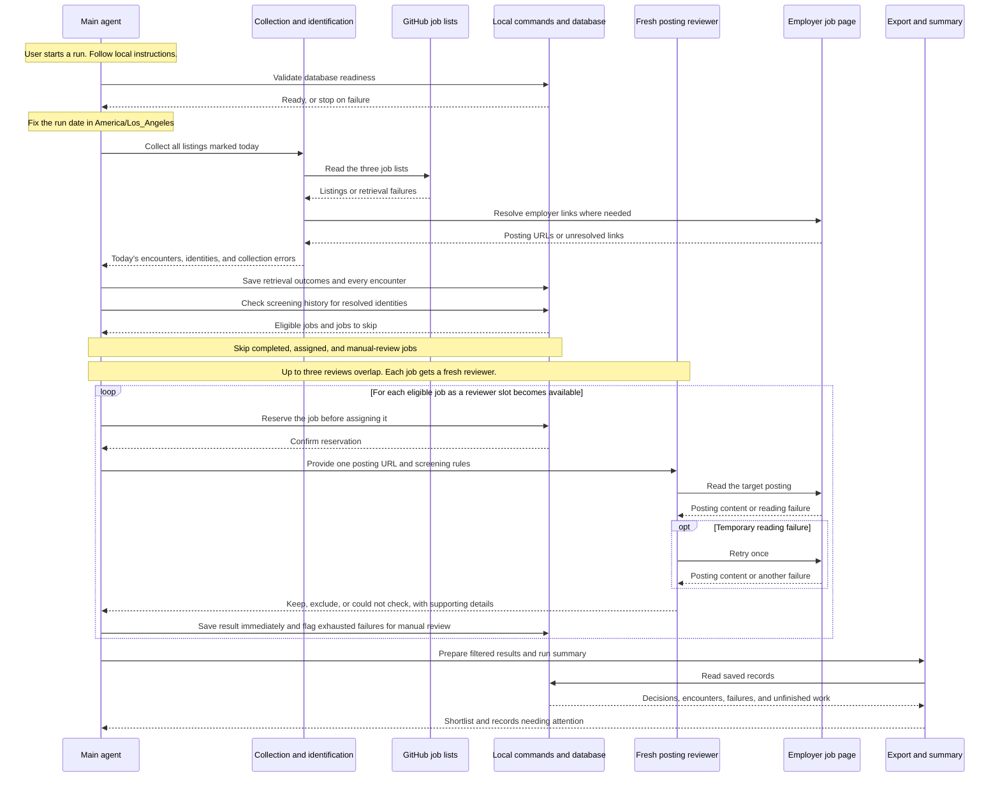

# Job Screening Workflow Design

## Problem Statement

Finding suitable new-grad software engineering jobs requires manually reviewing postings across multiple sources and checking employer pages for role requirements, location, application availability, and sponsorship or citizenship restrictions. Discovery lists alone cannot establish suitability because they may include internships, unrelated roles, or closed positions. The same posting can also appear across sources and on multiple days, creating repeated work without a reliable screening history. We need a simple workflow that turns today’s listings into a useful shortlist, prioritizes potentially suitable opportunities, and preserves screening decisions and unresolved cases for later reference.

## Technical Plan

The workflow will run locally when the user asks the main agent to start screening. The main agent will collect listings, coordinate individual job reviews, and save results through a small set of local commands. Markdown instructions will explain how to start a run, apply the screening rules, and handle failures.

The major components have the following responsibilities:

| Component | Role in the workflow |
| --- | --- |
| Main agent | Checks startup readiness, manages the work queue, assigns reviews, and saves each result as it finishes. It handles routine database writes so reviewers do not compete to update shared records. |
| Listing collection | Reads the SimplifyJobs, SpeedyApply, and Jobright GitHub lists and collects every listing marked as posted today. The run uses a fixed date in `America/Los_Angeles`; source retrieval failures are recorded separately from successful searches with no matching listings. |
| Job identification | Follows source links to the employer posting and identifies each job using a consistent company label plus a posting ID taken from its URL. If no ID can be extracted, it uses the complete employer URL. Different posting IDs remain separate jobs even when their descriptions match. |
| Posting reviewers | Each fresh reviewer reads one employer posting and checks its title, location, application availability, and explicit sponsorship, citizenship, or clearance restrictions. It returns a short decision with supporting evidence and uncertainty notes. A fresh reviewer for each job keeps earlier postings out of its review context. |
| Local commands and database | Store runs, source retrievals, every collected encounter, job assignments, and screening results. The commands check history and reserve work before a reviewer starts, preventing duplicate assignments. SQLite is the proposed storage engine. |
| Export and run summary | Produce a filterable shortlist and report exclusions, unresolved cases, and incomplete work from saved records. A local file for manual transfer to Google Sheets is the proposed first output; the final format and transfer method remain undecided. |

Each run begins by checking that the database is usable, then collecting all of today's listings before reviews begin. Every collected encounter is saved, including repeat appearances and unresolved employer links. Jobs with a completed screening are skipped indefinitely, while eligible jobs are assigned to up to three reviewers at once. As each reviewer finishes, the main agent saves its result and assigns the next job to a fresh reviewer.

A temporary reading failure gets one retry. If both attempts fail, the job is saved as `Could not check` for manual review and is not automatically retried on later runs. Saving results throughout the run preserves completed work if processing is interrupted; the policy for resuming unfinished jobs on a later date remains to be decided.

## Alternatives and Decision Guardrails

This section records the alternatives and boundaries documented in [JOB_SCREENING_DESIGN.md](JOB_SCREENING_DESIGN.md) and [JOB_SCREENING_IMPLEMENTATION_PLAN.md](JOB_SCREENING_IMPLEMENTATION_PLAN.md). The design document remains the authority for agreed requirements. Explicitly rejected or superseded ideas are distinguished below from implementation recommendations and choices that remain open. A future change to a settled rule should be presented as a change for the user to decide, with its tradeoff stated, rather than silently introduced as an implementation improvement.

### Alternatives excluded by settled decisions

Some alternatives below were explicitly proposed and rejected or superseded. Others are excluded by an agreed rule; their inclusion does not imply that a separate proposal or debate took place.

| Alternative | Decision, rationale, and guardrail |
| --- | --- |
| Collect each full current list and let screening history decide what to review; scan an initial backlog or catch up missed days. | The earlier full-list recommendation was superseded by today-only collection on every run. Use the GitHub row's displayed date or `0d`, against a fixed Los Angeles run date. Do not substitute employer dates, first-seen dates, or commit dates, or guess missing dates. Missing jobs between runs is an accepted tradeoff. Reading older rows while retrieving a source does not authorize collecting them. |
| Stop after 50 jobs or require checkpoints every 50 jobs. | The 50-job limit and batch checkpoint requirement were rejected. Collect all of today's matching rows at the beginning of the run and process all eligible jobs, subject to interruptions or execution limits. The limit of three applies to simultaneous reviewers, not the total number of jobs. |
| Merge jobs based on similar titles, descriptions, or URLs. | Similarity-based matching was explicitly rejected because distinct positions can share wording. Identity is a consistent company label plus a URL-derived posting ID, or the full-URL fallback. Different URL IDs remain separate even when descriptions or internal requisition IDs match. The same ID at different companies also remains separate. |
| Use a visible page ID or structured job metadata when extracting identity. | The earlier page-text and metadata fallback was superseded by URL-only extraction. Use a configured URL path segment or named parameter, not an arbitrary number or an aggregator's ID. In the recorded Roblox example, URL ID `8261393` wins over visible page ID `46811`. Keep IDs as text so prefixes and leading zeros survive. |
| Truncate a long fallback URL, normalize away its parameters, or reject a posting merely because no ID can be extracted. | The agreed fallback is the complete employer URL together with the company label. Truncation can merge distinct postings. Different fallback URLs, including tracking-parameter differences, remain different identities. Keep ID-based and URL-based identities distinct; shortening is allowed only for display. An unresolved employer URL is a separate problem and must not be replaced with a guessed identity. |
| Re-screen a completed job when it reappears, gains a new date, or changes its description. | Completed identities are skipped indefinitely, including both kept and excluded results. This avoids repeated review and deliberately accepts that later changes may go unchecked. Corrections or resets are explicit maintenance actions. Routine saving must preserve the existing completed result. |
| Omit repeat appearances from history or retain only shortlisted jobs. | Every collected encounter must be recorded, including completed jobs and jobs awaiting manual review. Skipping a review does not skip the history write. Keep exclusions and failed attempts as well; filtering or removing a job from an exported shortlist must not erase its screening history. |
| Reuse one long-running reviewer for many postings. | The user chose a fresh reviewer for each posting to avoid carrying earlier job details into later reviews. At most three reviewers run at once. This accepts additional model/tool usage and coordination overhead. Configure reviewers without inherited conversation history where supported; merely calling an agent “fresh” does not establish isolation. |
| Automatically broaden or modernize the title filter. | Preserve case-insensitive substring matching for `grad`, `graduate`, `graduates`, `early`, and `2026`. Do not add junior or entry-level synonyms, require whole-word inclusion matches, or replace `2026` with the current year. Missing some suitable titles and admitting words such as “undergraduate” are accepted limitations. Whole-word internship terms in the target title override inclusion; internship mentions elsewhere do not. |
| Require every remote role to be U.S.-based or prove the user's eligibility in its remote country. | Keep U.S. roles and remote roles regardless of country, even when a remote role explicitly restricts applicants to another country. This is a deliberate scope choice. Record remote locations as `Remote`; exclude non-U.S. roles that are not remote. |
| Require confirmed sponsorship or reject all ambiguous eligibility wording. | The user prioritized finding potentially suitable jobs. After a successful read, keep otherwise qualifying jobs when restrictions are absent or ambiguous, with a note for ambiguity. Exclude explicit sponsorship refusals and required citizenship or security clearance, including a requirement to obtain clearance. A sponsorship question or preferred clearance is insufficient. This screening assumption does not establish employer-confirmed sponsorship and never applies to unreadable pages. |
| Keep retrying unreadable postings or automatically retry them on later runs. | One retry is allowed after a temporary reading failure. After two failed attempts, record `Could not check` and leave the job for manual review until the user explicitly requests another attempt. Later encounters are still saved. Knowing the URL identity does not mean the posting was successfully screened. |
| Require a running HTTP service for database access. | The agreed access approach is a small local command-line interface documented in Markdown. Commands open storage, perform an operation, and exit. This supports simple setup and a manual start without operating a separate service. |

### Approaches discouraged by the proposed implementation

These entries preserve the reasoning behind the recommendations in the source documents. Their detailed implementation remains open; they should not be misrepresented as separately confirmed user decisions.

| Approach considered or shortcut cautioned against | Reason and recommended direction |
| --- | --- |
| Review keyword excerpts only. | Excerpts can omit restrictions or their context. The recommended starting point is review of the complete relevant description, with lightweight identity/title checks where useful. Deterministic pre-checks followed by AI review were also considered and remain compatible with this approach. |
| Treat a repository row as the final screening evidence, or infer closure from disappearance from a rolling list. | Discovery lists can contain unsuitable or closed roles, and rolling lists can drop jobs that remain open. Read the target employer posting. Keep related-job cards separate, and do not remove page endings blindly because eligibility language can appear there. An incomplete read or redirect to a general careers page is a reading failure. |
| Use only a list position to prevent duplicate work, or reassign automatically after a timeout. | A job may appear in several sources, and an earlier reviewer may still be active. The proposed interface checks eligibility and reserves the job in one operation before launching a reviewer. Confirm the old reviewer has stopped before reassignment, and associate results with their assignments so late results cannot overwrite another completion. |
| Let reviewers write shared records independently, save everything at the end, or rely on the agent to compose SQL correctly each time. | The proposed design has reviewers return compact results and the main agent save each result immediately through validated commands. The interface and database enforce identity, assignment, and repeated-save rules. This reduces conflicting writes and preserves completed work through interruptions. |
| Use a single status such as “first scan / already scanned / unrecognized.” | That cannot distinguish an encounter from a completed screening, an active assignment, or an exhausted failure. Keep appearance history, work state, screening outcome, and reading attempts separate. A full-URL fallback is a valid identity, not automatically an unrecognized job. |
| Treat failures as empty or successful results. | A failed source retrieval is not a successful search with zero jobs. A failed history lookup is not evidence of a new job. An unexpectedly missing database must not silently create empty history, and a failed write must not be reported as saved. Report failures and stop affected work where persistence is required. |
| Assume browser rendering, crawler rules, or a different access tool guarantees permission or availability. | The access discussion did not propose bypassing explicit restrictions. Use permitted retrieval methods and preserve inaccessible postings for manual review. Browser rendering can help with JavaScript but is not a remedy for every access denial. The exact retrieval tools remain undecided. |

### Deferred choices and boundaries that must not become invented decisions

| Topic | Recorded status |
| --- | --- |
| Google Sheets and export | Google Sheets is preferred, but direct integration is deferred. OAuth, a service account, local TSV, and local Markdown were discussed; none is permanently rejected. TSV is the simplest proposed handoff, not a finalized format. Columns, filters, current-run versus historical scope, append/replace behavior, application tracking, and clipboard convenience remain undecided or unrequested. A Google connection is not a prerequisite for local screening. |
| Storage and code structure | SQLite is recommended. The runtime, database location, exact schema, command names, company/account mappings, and description-retrieval tools remain open. Use explicit company mappings rather than guessing that similar names, parents, or subsidiaries are one employer. Unknown accounts, conflicting URL IDs, and unresolved employer links still need defined handling. |
| Interrupted work and effort limits | Resuming unfinished jobs from a previous date remains unresolved. Saving work does not authorize draining an older queue during today's run. Additional time or effort limits beyond the agreed retry rule are also undecided. |
| Automation and application architecture | A custom model API integration, dashboard, and automatic schedule are outside the initial scope. They were not established as necessary components or permanently forbidden future additions. The initial workflow starts manually in an agent session. |
| Extra eligibility rules and result wording | No graduation date, personal work-authorization timeline, or broader experience-based filter was established. Do not invent them. “No restrictions found” was recommended over “Sponsorship confirmed,” but the final output label remains open. |

These decisions define the proposed workflow; documenting them does not implement the system, start screening, connect accounts, or schedule runs.
