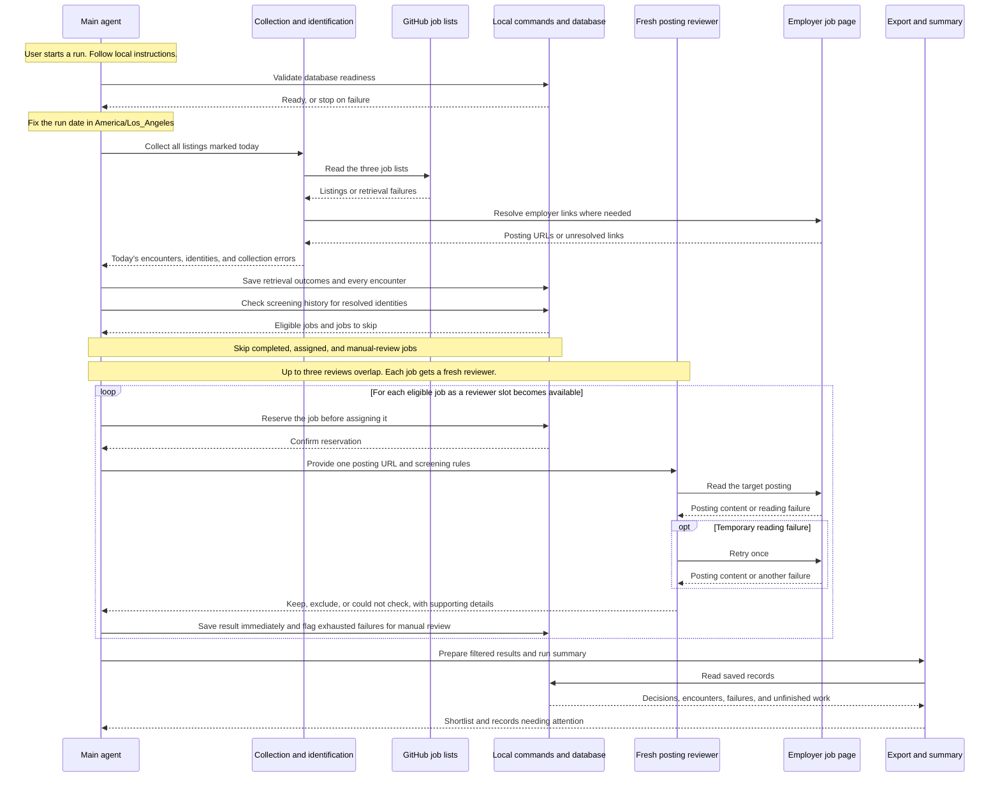

# Job Screening Workflow Design

## Problem Statement

Finding suitable new-grad software engineering jobs requires manually reviewing postings across multiple sources and checking employer pages for role requirements, location, application availability, and sponsorship or citizenship restrictions. Discovery lists alone cannot establish suitability because they may include internships, unrelated roles, or closed positions. The same posting can also appear across sources and on multiple days, creating repeated work without a reliable screening history. We need a simple workflow that turns today’s listings into a useful shortlist, prioritizes potentially suitable opportunities, and preserves screening decisions and unresolved cases for later reference.

## Technical Plan

The workflow will run locally when the user asks the main agent to start screening. The main agent will collect listings, coordinate individual job reviews, and save results through a small set of local commands. Markdown instructions will explain how to start a run, apply the screening rules, and handle failures.

The major components have the following responsibilities:

| Component | Role in the workflow |
| --- | --- |
| Main agent | Checks startup readiness, manages the work queue, assigns reviews, and saves each result as it finishes. It handles routine database writes so reviewers do not compete to update shared records. |
| Listing collection | Reads the SimplifyJobs, SpeedyApply, and Jobright GitHub lists and collects every listing marked as posted today. The run uses a fixed date in `America/Los_Angeles`; source retrieval failures are recorded separately from successful searches with no matching listings. |
| Job identification | Follows source links to the employer posting and identifies each job using a consistent company label plus a posting ID taken from its URL. If no ID can be extracted, it uses the complete employer URL. Different posting IDs remain separate jobs even when their descriptions match. |
| Posting reviewers | Each fresh reviewer reads one employer posting and checks its title, location, application availability, and explicit sponsorship, citizenship, or clearance restrictions. It returns a short decision with supporting evidence and uncertainty notes. A fresh reviewer for each job keeps earlier postings out of its review context. |
| Local commands and database | Store runs, source retrievals, every collected encounter, job assignments, and screening results. The commands check history and reserve work before a reviewer starts, preventing duplicate assignments. SQLite is the proposed storage engine. |
| Export and run summary | Produce a filterable shortlist and report exclusions, unresolved cases, and incomplete work from saved records. A local file for manual transfer to Google Sheets is the proposed first output; the final format and transfer method remain undecided. |

Each run begins by checking that the database is usable, then collecting all of today's listings before reviews begin. Every collected encounter is saved, including repeat appearances and unresolved employer links. Jobs with a completed screening are skipped indefinitely, while eligible jobs are assigned to up to three reviewers at once. As each reviewer finishes, the main agent saves its result and assigns the next job to a fresh reviewer.

A temporary reading failure gets one retry. If both attempts fail, the job is saved as `Could not check` for manual review and is not automatically retried on later runs. Saving results throughout the run preserves completed work if processing is interrupted; the policy for resuming unfinished jobs on a later date remains to be decided.
